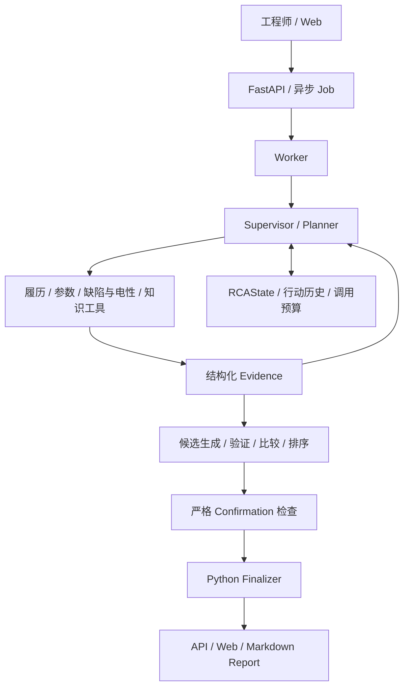

# Semiconductor Yield RCA Investigation Copilot

**Copilot v1 | 半导体良率异常调查助手**

将工程师的自然语言问题转成有状态、可追溯的 Agent 工作流：查询生产履历、设备参数和缺陷/电性数据，比较可能原因，说明证据缺口，并建议下一步检查。

项目使用**合成制造数据**，支持 **Qwen Plus / DeepSeek v4 Pro**。

## 调查结果

| 输出 | 含义 |
| --- | --- |
| Primary Suspected Cause | 当前主要疑似原因 |
| Strongest Alternative | 最有力的替代解释；不存在合法候选时保留为空 |
| Evidence Assessment | 支持、反驳及缺失证据 |
| Remaining Uncertainty | 尚未解决的不确定性 |
| Next Investigation | 建议补查的数据、量测或工程观察 |
| Confirmation Status | 是否达到严格确认标准 |

**疑似原因不等于已确认根因。** 零候选、单一候选和无法区分的候选都可以形成诚实的调查结果；系统不会为了填满报告而伪造原因。

## Agent 架构



1. **工作流：** Planner 提议下一步，Supervisor 校验并调度专业角色，执行有预算和停止条件的反馈循环。
2. **工具：** 通过数据访问层查询制造数据，返回带 ID、来源、设备和时间的结构化证据。
3. **状态：** RCAState 保存调查目标、证据、候选和行动历史；模型每次只接收当前任务所需的有限上下文。
4. **候选：** 比较支持证据、反证及替代机制，保留尚未解决的争议和区分候选所需的数据。
5. **结论：** Python 控制引用、范围、候选准入和结果发布。Investigation Authority 与 Confirmation Authority 分开，Copilot 输出不会放宽严格确认标准。

> **LLM proposes; Python owns authority.**
>
> LLM 提出假设、解释和建议；Python 负责校验和结果写入；工程师负责最终因果确认与生产动作审批。

## 工程能力

- **模型接入：** Model Runtime / Provider Adapter 统一接入 Qwen、DeepSeek，支持每个 Job 选择模型并记录实际身份。
- **异步执行：** FastAPI 创建任务，独立 Worker 执行，PostgreSQL 保存状态、事件和结果，React 展示进度和报告。
- **结构化合同：** Pydantic API 模型、typed Evidence 和版本化 `triage/1.0` 输出。
- **可观测性：** 记录模型与工具调用、Token 用量、耗时、错误和停止原因；网络重试、输出修正和任务恢复具有独立边界。
- **知识检索：** 支持历史案例、SOP 和工程笔记查询；混合检索与重排按配置启用。

## 快速开始：离线 CSV 演示

要求 Python 3.11+。以下演示无需数据库、容器或模型 API key：

```bash
python -m venv .venv
# Windows: .venv\Scripts\activate
# Linux / macOS: source .venv/bin/activate
python -m pip install -e ".[dev]"
python scripts/run_golden_rca.py --no-print-report
```

结果写入本地 `outputs/golden_rca_run/`，不会进入版本库。离线演示使用确定性兼容路径，不能据此推断真实模型准确率。

## Web / API 与模型配置

- [运行指南](docs/GETTING_STARTED.md)：PostgreSQL、API、Worker、前端及 Docker Compose。
- [本地配置](docs/configuration.md)：仓库不分发 `.env` 或真实密钥，使用者自行在本地设置。
- 真实 Agent 路径需显式配置 `YIELD_RCA_AGENT_MODE=llm`、`YIELD_RCA_ORCHESTRATION_MODE=llm_react` 并提供模型密钥，会产生 API 费用。
- Web / API 允许 `dashscope / qwen-plus` 和 `deepseek / deepseek-v4-pro`，选择会影响 Worker 的实际执行路径。
- 冻结的 Compose 配置只转发 DashScope 密钥；DeepSeek 可通过宿主机 API / Worker 环境运行，不宣称 Compose 已完成 DeepSeek 端到端部署验证。

## 开发与测试

```bash
python -m pytest tests -q
python -m ruff check core backend tests tools
```

```bash
cd frontend
pnpm install
pnpm run check
pnpm run build
```

真实模型、PostgreSQL 和外部输入相关检查有独立条件。软件回归、真实 API 功能验证和语义质量评估使用不同口径；测试通过不等于根因准确率已验证。

## 代码导航

| 模块 | 入口 |
| --- | --- |
| 编排与共享状态 | [`workflow.py`](core/yield_rca_core/workflow.py)、[`supervisor.py`](core/yield_rca_core/supervisor.py)、[`models.py`](core/yield_rca_core/models.py) |
| 工具与证据 | [`tool_layer.py`](core/yield_rca_core/tool_layer.py)、[`evidence_models.py`](core/yield_rca_core/evidence_models.py) |
| 候选生成 | [`hypothesis_candidate_generator.py`](core/yield_rca_core/hypothesis_candidate_generator.py) |
| 比较与确认 | [`causal_candidate_comparison.py`](core/yield_rca_core/causal_candidate_comparison.py)、[`causal_confirmation.py`](core/yield_rca_core/causal_confirmation.py) |
| 结果发布 | [`investigation_finalizer.py`](core/yield_rca_core/investigation_finalizer.py)、[`triage_result.py`](core/yield_rca_core/triage_result.py) |
| 模型接入 | [`model_runtime.py`](core/yield_rca_core/model_runtime.py)、[`providers/`](core/yield_rca_core/providers/) |
| API / Worker / Web | [`backend/yield_rca_api/`](backend/yield_rca_api/)、[`frontend/src/`](frontend/src/) |

## 文档与边界

- [Copilot v1：职责、输出和证据边界](docs/COPILOT_V1.md)
- [异步任务队列](docs/async-job-queue.md)
- [可观测性](docs/observability.md)
- [Triage 结果合同](docs/copilot_v1/r1/AUTHORITY_RESULT_CONTRACT.md)

数据为离线合成数据；真实 Fab 集成、生产效能提升和生产级身份认证未在本项目中完成。专业角色由 Supervisor 调度，不宣传独立自治或各自维护长期记忆。工程建议交由人处理，系统不执行设备调参或停机等生产动作。

Copilot v1 功能已冻结。
